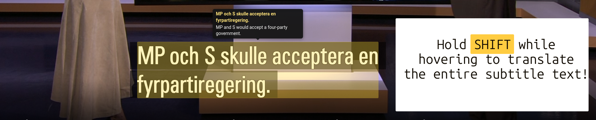
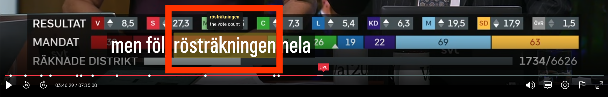
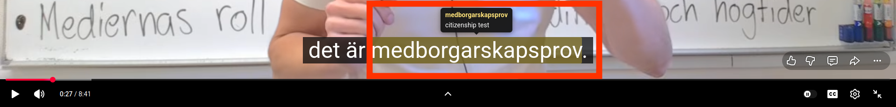
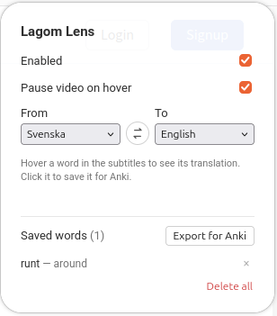

#  Lagom Lens

🇸🇪 Svenska · 🇬🇧 English · 🇪🇸 Español · 🇩🇪 Deutsch · 🇫🇷 Français · 🇮🇹 Italiano · 🇵🇹 Português · 🇳🇱 Nederlands · 🇵🇱 Polski · 🇷🇺 Русский · 🇯🇵 日本語 · 🇨🇳 中文 · 🇮🇳 हिन्दी

Lagom Lens is a minimal browser extension which helps you to learn a new language.
Hover a word in subtitles (YouTube, SVT Play or Netflix) to see a translation in your chosen language.

> [!TIP]
> **Hold <kbd>Shift</kbd> while hovering** to translate the whole subtitle line instead of just one word.

## Revise with Anki

**Click a word while its translation is showing** to save it,
together with the subtitle line you heard it in as an example sentence.
Hold <kbd>Shift</kbd> while clicking to save the whole line instead.
Saved words get a ★ in the tooltip, and are listed in the extension's popup.

To revise them with [Anki](https://apps.ankiweb.net/):

1. Click **Export for Anki** in the popup. This downloads `lagom-lens-anki.tsv`.
2. In Anki, choose **File → Import** and pick the file.
3. Check that the note type is **Basic**, then click **Import**.

Each word becomes a card in a **Lagom Lens** deck. The front shows the word and its
sentence, and the back shows their translations.
You can export again whenever you've saved more words. Anki updates the cards it
already has, without losing their review history.

It works by manipulating the DOM elements of the page and then querying
https://mymemory.translated.net/ for translations.

## Why?

I was tired of having to pause videos, type words into my translator, and then resume the video.
Lagom Lens lets you hover over a word and see the translation instantly.

## Screenshots

#### SVT Play

> rösträkningen -> the vote count

#### YouTube

> medborgarskapsprov -> citizenship test

#### Language Menu

## Install from source (Chrome/Edge/Brave)

1. Go to `chrome://extensions`
2. Enable **Developer mode** (top right)
3. Click **Load unpacked**
4. Select this folder (`lagom-lens`)
5. Open a Swedish YouTube video, an SVT Play video or a Netflix title, turn on subtitles

## Install from source (Firefox)

1. Go to `about:debugging#/runtime/this-firefox`
2. Click **Load Temporary Add-on…**
3. Select `manifest.json` inside this folder (not the folder itself)
4. Open a Swedish YouTube video, an SVT Play video or a Netflix title, turn on subtitles

Note: a temporary add-on is removed when Firefox restarts — reload it from
`about:debugging` again next session.

## FAQ

1. How do I translate a whole sentence instead of one word?
    - Hold `Shift` while hovering over the subtitle.

2. I was hovering and the video moved so the subtitles changed.
    - I recommend pausing the video while you hover.
      I also assume that if you are learning Swedish, you probably don't watch the video at full speed anyway so you shouldn't have this problem too often.

3. Why Lagom Lens?
    - "Lagom" is a Swedish word that roughly translates to "just right" or
      "moderate".
      Lens is inspired from Google Lens and isn't too complex like computer vision and not too simple like a dictionary lookup.
